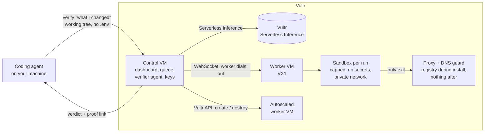

# verify

**Coding agents don't get to say done. They prove it.**

When a coding agent finishes a change, it runs `verify`. An independent agent on Vultr reads the diff, writes its own test scenario, starts the app in a throwaway sandbox, drives it, and sends back proof: screenshots, a screen recording, network and memory numbers, and a verdict. The coding agent reads the result inside its own turn, fixes what broke and runs `verify` again before it tells you it's finished.

Built for the [Vultr Agent Rush hackathon](https://lablab.ai/ai-hackathons/vultr-hackathon), challenge 1 (Blast Radius Zero).

## The problem

Coding agents are good at writing a change and honest about what they didn't check, but checking is the slow part, so it gets skipped. On a real Expo project we looked at (51 agent sessions), agents mostly tested one platform and left the other out, and the person running them kept asking "did you test on both platforms?". Several agents running at once also share a handful of simulators and emulators: one session's reset wiped another session's app mid-test, Metro servers on the same port served each other's bundles, and the person ended up hand-assigning devices in chat.

verify takes that work off the agent and the person: one command, a fresh isolated device per run, a queue for the scarce ones, and proof attached to the answer.

## How it works



1. **The agent runs `verify "added a delete button to each item"`.** The CLI packs the git working tree (tracked and untracked files, never `.env*`), the diff against `main` and the repo's `verify.yml`, uploads them and waits.
2. **The queue picks a sandbox.** Waiting agents go before webhooks, cheap checks before expensive ones (Android only runs after web passed), a newer `verify` from the same branch replaces the older one, and a job for several platforms fans out into parallel runs. Runs are packed onto workers by CPU and memory, preferring a worker that already has the repo's saved image. When a run has waited 30 seconds, the control VM creates another worker from a snapshot through the Vultr API (it joins in 7 to 11 minutes), and destroys it after 5 idle minutes.
3. **The worker prepares the app.** The first run for a repo and lockfile installs dependencies inside the sandbox and saves the result as an image, so later runs start warm (anything the install tried to reach is stored with the image and reported again on every warm run). Every run still gets a fresh container. For Android, an Android 14 emulator boots inside the same sandbox from a saved state, installs the app's debug build, and loads the changed JavaScript from Metro, so JS-only changes need no native rebuild.
4. **The verifier agent tests it** (Vultr Serverless Inference). It reads the diff and what is on screen (accessibility tree and the list of interactive elements), writes a scenario with expected results and edge cases before anything runs, and turns it into a script: Playwright for web, a Maestro flow for Android. The script only acts and takes screenshots; it never decides pass or fail. If the script itself breaks before it gets anywhere, the verifier fixes it once. If it breaks partway and nothing has failed so far, the verifier rewrites it and runs every check again before it gives a verdict. After the scenario the app sits idle for 10 seconds while memory is sampled.
5. **It judges the evidence.** The vision model reads every step's screenshot against the planned checks, together with measured facts: blocked network attempts, memory peak, crashes, console errors. Verdict: pass, fail or couldn't verify, with steps to reproduce.
6. **The sandbox is destroyed** (container, network, files), and the proof stays on the dashboard.

## What it can verify

| | Now | Later |
| --- | --- | --- |
| Web | Any app with a dev server (Vite, Next.js, Create React App, static sites, Expo web), driven in Chromium by Playwright | Firefox and WebKit, Lighthouse and accessibility scores |
| Mobile | Expo and React Native on an Android 14 emulator inside the sandbox, driven by Maestro | Several Android versions side by side, iOS on Mac workers |
| Other | | Backend and API checks, database migrations on a throwaway copy, command-line tools with a terminal recording, proof posted on the pull request |

Any repo works the same way: the coding agent writes a short `verify.yml` once (how to install the app, start it and reach it), and from then on the verifier reads each diff and decides what to check.

## Containment

Each run gets:

| | |
| --- | --- |
| Process isolation | Its own Docker container on a worker VM. The control VM, which holds every key, never runs untrusted code. |
| No secrets | No environment variables beyond the proxy address. The CLI never uploads `.env` files. The worker token lives outside the container. |
| Network | A private `--internal` Docker network. The only other member is a guard container: an HTTP proxy that allows the package registry during install and nothing during the run (plus any hosts listed under `allow:`), and a DNS server that answers nothing and logs every lookup. Blocked attempts show up in the report even when code ignores proxy settings. The cloud metadata address is unreachable. |
| Limits | 2 CPUs, a 3 GB memory cap (6 GB for Android runs, swap off), 4096 processes, all Linux capabilities dropped, `no-new-privileges`, a 2-minute script timeout. |
| Lifecycle | Container, network and files are removed after every run. |

The demo shows two containment moments:

- **A bad package.** The agent adds a haptics package whose install script tries to send the machine's environment to `collect.pkg-telemetry.example`. The lookup is blocked and logged during install, and the change fails with the log as proof. (The package is a harmless local demo tarball. It sends variable names only, to a `.example` domain that cannot resolve. It is not published anywhere.)
- **A memory leak.** The agent adds a "last saved" clock whose effect has no cleanup, so timers multiply. The sandbox hits its 3 GB cap and the kernel kills the browser. The report shows the memory chart running into the cap, while other runs on the same worker carry on.

## Vultr services used

- **Vultr Cloud Compute** for the control VM: web app, API, queue, verifier agent, Caddy for HTTPS.
- **Vultr VX1 Cloud Compute** for worker VMs that run the sandboxes. VX1 exposes KVM, which the Android emulator needs.
- **Vultr API** to create workers from a snapshot when the queue backs up and destroy them when idle.
- **Vultr Serverless Inference** (OpenAI-compatible) for every model call: planning the scenario, writing and repairing the Playwright script, judging the screenshots.

## Try it

The public demo has a **Try it** page with four changes an agent made to a small Expo packing list app: a working feature, a broken delete button, the bad package and the memory leak. Press Verify and watch the run. The dashboard shows the fleet, the queue and every verification. The demo video is on the lablab submission.

## Use it from Claude Code (the skill)

`skill/verify/` is a Claude Code skill. Install it once:

```bash
npm install -g ./packages/cli
verify login https://your-verify-server <token>
cp -r skill/verify ~/.claude/skills/
```

Then in any repo, when the agent finishes a change (or when you type `/verify`), the skill works out how the project runs from `package.json`, the framework config and the README, writes `verify.yml` if it's missing, runs `verify`, fixes what the report says is broken, runs it again, and ends with one line per platform and the proof link. For an Expo app it looks for a debug APK in the README, `eas.json` or the docs and adds Android when it finds one; without one it verifies the web only and says so.

In the demo, Claude adds a delete button and runs `/verify`. The skill finds the Android debug build in the README and writes a `verify.yml` for web and Android. The first run fails on web (the delete button removes the item below the one tapped), so Android is skipped. Claude fixes the bug, and the second run passes on both:

```
web: PASS, 5 checks
android-34: PASS, 5 checks
Proof: https://…/#/jobs/…
```

## Use it on your own repo

```bash
npm install -g ./packages/cli          # or run node packages/cli/verify.ts
verify login https://your-verify-server <token>
```

Add `verify.yml` to the repo root (when it is missing, `verify` prints the format so the coding agent can write it):

```yaml
install: npm install --no-audit --no-fund
start: npx expo start --web --port 8081
ready: http://localhost:8081
platforms: [web]
allow: []
android_apk: https://your-host/builds/app-debug.apk
android_package: com.example.app
android_start: npx expo start --port 8081
```

Run `verify "..." --on web,android-34` to test on both.

Then tell your coding agent, for example in `CLAUDE.md` or `AGENTS.md`:

```
Before saying a task is done, run: verify "<what you changed and what to check>"
Exit code 0 means it passed. Otherwise read the report, fix the problem and run verify again.
```

## Limits today

- Apps that need a login or a real backend don't work yet: the sandbox holds no secrets and can only reach hosts listed under `allow:`. Test logins injected at the proxy are the next step.
- iOS needs macOS, which Vultr doesn't offer.
- An autoscaled worker takes 7 to 11 minutes to restore from its snapshot, so bursts wait on the always-on worker first.
- The verifier is a model: it picks slightly different checks each run. Its verdicts come with the screenshots so you can check them.

## Run it yourself

Requirements: Node 22.18 or newer (runs TypeScript directly), Docker.

```bash
npm install
docker build -t verify-base sandbox
(cd packages/web && npx vite build)
VULTR_INFERENCE_KEY=... node packages/control/server.ts      # http://localhost:7300
CONTROL_URL=http://localhost:7300 node packages/worker/worker.ts
```

Deploying to Vultr: `node infra/vultr.ts create control` and `node infra/vultr.ts create worker`, then `infra/deploy.sh control <ip> <env-file>` and `infra/deploy.sh worker <ip> <env-file>`. Settings:

| Control | |
| --- | --- |
| `VULTR_INFERENCE_KEY` | Serverless Inference key |
| `VERIFY_MODEL`, `VERIFY_VISION_MODEL` | model ids, default `glm-5.3` |
| `VERIFY_TOKENS` | comma-separated CLI tokens |
| `WORKER_TOKEN` | shared with workers |
| `PUBLIC_HOST`, `PUBLIC_CONTROL_URL` | for Caddy and for autoscaled workers |
| `VULTR_API_KEY`, `WORKER_SNAPSHOT_ID`, `WORKER_PLAN`, `MAX_WORKERS` | autoscaling |

| Worker | |
| --- | --- |
| `CONTROL_URL`, `WORKER_TOKEN`, `WORKER_NAME` | where to connect and as whom |

## Layout

```
packages/cli       the verify command
packages/control   API, queue, autoscaler, verifier agent, Vultr API client
packages/worker    sandbox lifecycle on each worker VM
packages/web       dashboard (React + Vite)
packages/shared    types shared by control and worker
sandbox            base image: Playwright, the runner, the network guard
demo-app           the Expo demo app and its four prepared changes
infra              VM setup and deploy scripts
```

## What existed before the event

Nothing. Everything here was written during the hackathon (3 to 8 November 2026). It uses open-source tools: Docker, Playwright, Expo, React, Vite, the `ws` package and Caddy.

## License

MIT
